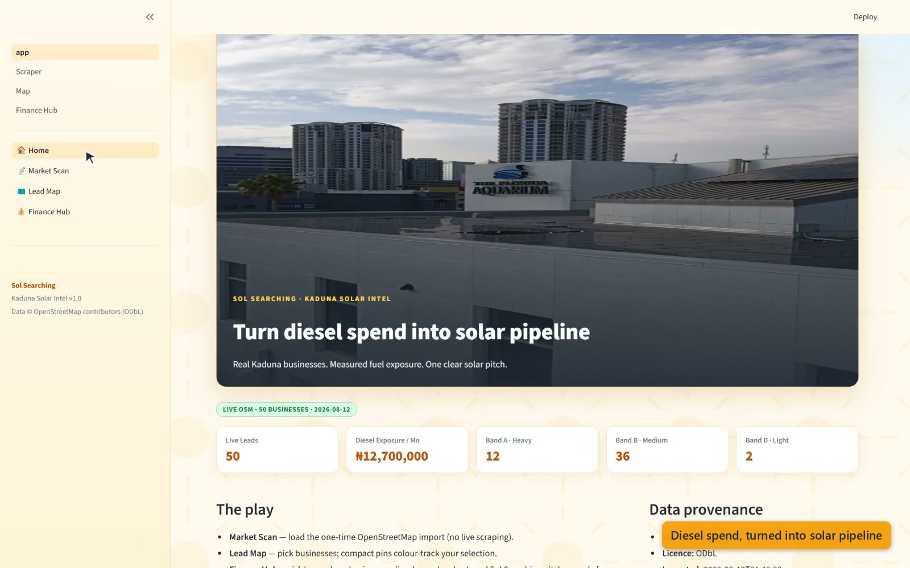

# Spec — Sol Searching walkthrough video

**Request short name:** `walkthrough-video`
**Status:** built — `docs/demo/sol_searching_walkthrough.mp4` (2:10) + `01_cover.jpg` +
`captions.json`, reproduced by `scripts/build_walkthrough.py`

**Delivered vs this spec:** five leads (ids 1–5: two Band A, three Band B) instead of six —
the Band D row sat below the fold in the canvas grid, and reaching it cost 90 s of toggling
flashes on camera. Music cue moved to **0:14**. Recorded against the locally-run app, not the
Streamlit Cloud URL, because that app is private and its sign-in could not be completed from
the automation browser. Pitches on screen are the app's canned fallback: the Gemini
free-tier quota returned HTTP 429 during the take.
**Repo:** `kaduna-solar-lead-gen` (`https://github.com/batestguy/kaduna-solar-lead-gen`, branch `main`)
**Live app:** `https://kaduna-solar-lead-ge-y3wljh2pqvkadljhlytgkg.streamlit.app`
**Date:** 2026-11-04

---

## 1. The request

> "Let's create a walkthrough video for our Streamlit app, click through every feature and
> add a short explanation in subtitles for what the screen is showing — keep it short and
> brief so it doesn't overpower the screen, use the right colour too. Learn from the MPI
> Inequality video we have on our git repo too."

Plus mid-session clarification: the background song is **Atlantic Starr — "Let the Sun
In"**, and it must **start at 1:12**.

In one sentence: produce a ~2:45 narrated-by-subtitle screen film of the live Sol
Searching app that mirrors the visual grammar of the existing MPI Equity Atlas demo, with
music from 1:12 of the Atlantic Starr track, delivered as `docs/demo/` mp4 + cover linked
from `README.md`.

---

## 2. Context gathered

### 2.1 The app (what has to appear on screen)

Four pages, shared shell in `ui.py`, brand **Sol Searching**, all runtime data offline from
`data/kaduna_leads.csv` (50 rows).

| Page | File | Screen content worth filming |
|---|---|---|
| Home | `app.py` | Hero banner + `source_badge` (Live OSM · 50 businesses), 5 KPI cards, "The play" 3-bullet summary, "Data provenance" panel (source / licence / imported / rows), footer |
| Market Scan | `pages/1_Scraper.py` | "Load Market Snapshot" primary button → staged progress bar → success toast → 5 KPI cards → "Top fuel-spend businesses" 10-row table → "Proceed to Lead Map →" |
| Lead Map | `pages/2_Map.py` | 50 teardrop pins (20×26, amber A / turquoise B / coral D, dark ring when selected), in-map legend card, attribution line, `st.data_editor` selection panel (tick `Selected`), "🔄 Refresh Map", "Save Selected & Analyse →", "**n** of 50 leads selected" |
| Finance Hub | `pages/3_Finance_Hub.py` | 6-card portfolio snapshot, caption on the ₦3,000,000 / ₦85,000 assumption, 3-column brief (Economics / Priority queue / Sales motion), Risk–reward scatter, Diesel-vs-solar grouped bars (top 10), "more below" table, AI pitch cards with SMS/Email badges, Advisory table + Model assumptions card, CSV export button |

Facts that must stay accurate on camera:

- Home KPIs: **50** leads · **₦12,700,000** exposure/mo · Band A **12** · Band B **36** · Band D **2**.
- Bands: A = ₦450,000/mo, B = ₦200,000/mo, D = ₦50,000/mo; installment ₦85,000; system ₦3,000,000 over 36 months.
- Advisory tiers: 🟢 Immediate ROI > ₦300k · 🟡 Strong Candidate > ₦100k · 🔴 Educate First ≤ ₦100k.
- Grid-supply hours are **illustrative assumptions**, not measured outages — the UI says so; the film must not imply otherwise.
- Data is real OpenStreetMap (ODbL); the app **never scrapes at runtime**.

### 2.2 The reference video, measured

`../TableauNigeria MPI Equity Atlas/docs/demo/atlas_demo.mp4` (sibling repo, "our git repo"):

| Property | Value |
|---|---|
| Resolution / fps | 1600×1000, 30 fps |
| Codec | h264 video + AAC 44.1 kHz stereo |
| Duration / size | 161.03 s (2:41) / 8.0 MB, ~398 kbps |
| Captions | Small **rounded pill, bottom-right**, solid green fill, white ~16 px sans text, one phrase per beat, declarative ("*Overview — where poverty sits, where it clusters, what it is made of*"). No title cards, no lower-third bars, no speaker. |
| Motion | Static screen with real cursor moving and clicking; page-level changes cut without transitions; no zoom-ins, no Ken Burns. |
| Audio | Licensed track committed at repo root (*Motherland* — Sound Sultan), music only, no voiceover. |
| Packaging | `docs/demo/*.jpg` stills + `atlas_demo.mp4`; README has a **clickable cover thumbnail** linking to the mp4. |

**What we inherit:** viewport capture at 1600×1000/30, short declarative bottom-right
pill captions, real clicks and hovers, music-only audio, `docs/demo/` + clickable README
cover.
**What we deliberately change:** pill colour (amber, on brand), no browser chrome (the MPI
film shows Tableau chrome), animated click rings (MPI has only a plain cursor), and a brand
end card (MPI ends on the viz).

---

## 3. Decisions locked by interview

| # | Question | Decision |
|---|---|---|
| 1 | Caption look | **Amber pill with the same geometry as MPI** — `#F59E0B` fill, dark ink text, bottom-right |
| 2 | Runtime | **~2:40, MPI parity** — all six feature areas: snapshot, brief, both charts, pitches, advisory + assumptions, export |
| 3 | Recording target | **Live Streamlit Cloud URL** (not localhost) |
| 4 | Audio | **Music only**, faded in/out, no voiceover, no SFX |
| 5 | Delivery | **`docs/demo/` mp4 + README link, like MPI** |
| 6 | Pitch state | **Real Gemini pitches** — `GOOGLE_API_KEY` set in Cloud secrets first; the "API Key Missing. Pitches simulated." box must never be in frame |
| 7 | Map basemap | **CARTO Voyager** — `CARTO_API_KEY` set in Cloud secrets; no "API KEY REQUIRED" watermark |
| 8 | Framing | **Viewport only, no browser chrome** (16:10 at 1600×1000) |
| 9 | Cursor | **Enlarged cursor + amber click ring** |
| 10 | Ending | **Brand end card** with wordmark, live URL, 07061674831 over the music fade |
| 11 | Git | **Commit the video, gitignore the song** |
| 12 | Caption voice | **Declarative** — name what the screen is, never instruct |
| 13 | Caption size | **≤7 words, 13–16 captions** |
| 14 | Selection on camera | **6 leads: 2×Band A, 3×Band B, 1×Band D** |
| 15 | Capture size | **1600×1000 @ 30 fps** (MPI parity) |
| 16 | Empty state | **Skip it** — happy path only |
| 17 | Music overrun | **Hard fade out over the last 3 s**; no looping; keep the cut ≤ 2:47 |
| 18 | Song path | **`assets/music/let-the-sun-in.mp3`** (copied, gitignored) |
| 19 | Caption motion | **Quick fade in/out (~0.2 s)** |
| 20 | Committed machinery | **Reproducible build script** (`scripts/build_walkthrough.py`) |
| 21 | README | **Clickable cover thumbnail**, like MPI |

---

## 4. Goals and non-goals

**Goals**
1. A single self-contained `mp4` a client can watch with sound, subtitles and no
   explanation from a human.
2. Faithful to the real app: real clicks, real data, real Gemini pitches, real live URL.
3. Rebuildable after any UI change — one script, one captions file.
4. Visually a sibling of the MPI film, but unmistakably Sol Searching.

**Non-goals**
- No change to app behaviour, page structure, styling, `requirements.txt`, or data.
- No voiceover, no talking head, no SFX.
- No mobile/responsive shot, no 719 px breakpoint demo.
- No YouTube/Vimeo upload, no LinkedIn cut, no GIF teaser.
- No demo of the Finance Hub empty state, the error paths, or the export download itself
  (hover only).
- No fabricated numbers: every on-screen figure is whatever the app computes.

---

## 5. Deliverables

```
docs/demo/
  sol_searching_walkthrough.mp4     # 1600x1000, 30 fps, h264 + AAC, ~2:45, target <15 MB
  01_cover.jpg                      # Home hero + first caption, clickable README thumbnail
  captions.json                     # single source of truth for the 15 caption beats
scripts/
  build_walkthrough.py              # Playwright capture + Pillow pills + ffmpeg burn/mux
assets/music/
  let-the-sun-in.mp3                # copied from repo-root download, GITIGNORED
.walkthrough_tmp/                   # raw webm, rehearsal takes, pill frames, GITIGNORED
README.md                           # + clickable cover + "Watch the 2:45 walkthrough" line
.gitignore                          # + assets/music/, *.mp3, .walkthrough_tmp/
```

Filename is deliberately not `atlas_demo.mp4`: both films may sit side by side in a
portfolio.

---

## 6. Film structure — beat sheet

Total target **2:45 (165 s)**, hard ceiling **2:47** (music availability from 1:12).
Dwell: 4.0 s minimum, 12 s maximum per caption. Three beats carry no caption (pure
navigation cuts) so the pill never feels continuous.

| # | Time | Page | On-camera action | Caption (≤7 words) |
|---|---|---|---|---|
| 1 | 0:00–0:07 | Home | Hero settles, cursor drifts in from bottom-right | *Diesel spend, turned into solar pipeline* |
| 2 | 0:07–0:15 | Home | Slow scroll over the 5 KPI cards, pause on ₦12,700,000 | *Fifty leads, ₦12.7m diesel every month* |
| 3 | 0:15–0:22 | Home | Scroll to "Data provenance" panel, cursor hovers ODbL line | *Real OpenStreetMap data, imported once* |
| 4 | 0:22–0:28 | Home → Market Scan | Sidebar click on 📡 Market Scan, new page paints | — (no caption) |
| 5 | 0:28–0:41 | Market Scan | Click **Load Market Snapshot**, progress runs, success toast lands | *One click stages the frozen import* |
| 6 | 0:41–0:49 | Market Scan | KPI cards in, scroll to top-10 table, hover 2 rows | *Twelve heavy users dominate the spend* |
| 7 | 0:49–0:55 | Market Scan → Map | Click **Proceed to Lead Map →** | — (no caption) |
| 8 | 0:55–1:05 | Lead Map | All 50 pins, legend card read, one small zoom-in | *Fifty businesses, coloured by diesel band* |
| 9 | 1:05–1:19 | Lead Map | Tick 6 checkboxes: ids 2, 3 (A) · 1, 4, 5 (B) · 19 (D), scrolling the editor panel to id 19 | *Tick targets — pins gain dark rings* |
| 10 | 1:19–1:25 | Lead Map | Pause on "6 of 50 leads selected", click **Save Selected & Analyse →** | *Six selected, ready for analysis* |
| 11 | 1:25–1:37 | Finance Hub | Portfolio snapshot 6 cards, slow horizontal read | *Portfolio snapshot: spend, saving, payback* |
| 12 | 1:37–1:47 | Finance Hub | 3-column brief: hover priority queue row | *Economics, priority queue, sales motion* |
| 13 | 1:47–1:59 | Finance Hub | Risk–reward scatter: hover a Band A bubble then a Band D bubble | *Risk versus reward, bubbles sized by diesel* |
| 14 | 1:59–2:09 | Finance Hub | Diesel-vs-solar bars: hover one orange bar, then one green bar | *Diesel bars dwarf the flat installment* |
| 15 | 2:09–2:21 | Finance Hub | Scroll pitch cards; hover the SMS badge then the Email badge | *One ready-to-send pitch per lead* |
| 16 | 2:21–2:31 | Finance Hub | Advisory table scan, 4 s on Model assumptions card | *Advisory flags who to call first* |
| 17 | 2:31–2:37 | Finance Hub | Hover ⬇️ Download CSV (never click) | *CSV hand-off for the sales rep* |
| 18 | 2:37–2:45 | End card | Card fades in over a still of the Finance Hub | — (card, not a pill) |

**15 captions** — inside the 13–16 target.

### 6.1 Expected on-screen figures (use to verify the take)

Six selected leads (2×A, 3×B, 1×D) → Finance Hub should read:

| KPI | Value |
|---|---|
| Leads in Analysis | 6 |
| Diesel Spend / Mo | ₦1,550,000 |
| Solar Installment / Mo | ₦510,000 |
| Potential Saving / Mo | ₦1,040,000 |
| Avg Payback | ≈18.9 mo (5 eligible leads) |
| Immediate ROI Leads | 2 |

The Band D lead (no phone, diesel below installment) shows a **blank payback** and an
**Email** badge — that is the honest "educate first" example and should stay in frame for
one beat, not be edited out.

Lead choice (verified against `data/kaduna_leads.csv`):

| Band | id | Name | Channel |
|---|---|---|---|
| A | 2 | Maneks Hospital | SMS |
| A | 3 | Epsilon Specialist Hospital | SMS |
| B | 1 | Alpha Chemicom Ltd | SMS |
| B | 4 | The Tea Place By Jsen Delights | SMS |
| B | 5 | Stonetech | SMS |
| D | 19 | Abdullahi Mai Littattafai | Email (no phone) |

Ids 1–5 are within the first rows of the editor panel; id 19 needs one panel scroll, which
is itself useful footage. If a name changes in the CSV, the `captions.json` lead list and
the expected figures above must be recomputed.

---

## 7. Caption design spec

| Property | Value |
|---|---|
| Fill | `#F59E0B` (app `primaryColor` / `--sun`) at 96 % opacity |
| Text | `#1F2937` (app `--ink`), semibold |
| Geometry | Rounded rect, corner radius **10 px**, padding **9 px 15 px**, computed width, max **600 px**, max 2 lines |
| Position | Bottom-right: right **34 px**, bottom **34 px** from the 1600×1000 frame |
| Size | 21 px Segoe UI Semibold (fallback DejaVu Sans Bold) — visually ≈ MPI's pill at the same frame size |
| Shadow | Soft `0 2px 8px rgba(31,41,55,0.35)` |
| Motion | Fade in 0.2 s, hold, fade out 0.2 s |
| Length | ≤7 words, target ≤42 characters; no full stop; em dash allowed as separator |
| Voice | Declarative, present tense, names the screen's job; never "click here", never first person |
| Naira | `₦` rendered by the chosen font (verify U+20A6 glyph; DejaVu Sans and Segoe UI both cover it). Never write "N12.7m" |

**Safe areas — the pill must never cover:**

1. **OpenStreetMap/CARTO attribution** (bottom-right *inside* the Leaflet map). This is a
   licence obligation, not cosmetics. → Captions on **Lead Map** beats (8, 9, 10) use
   `anchor: "bottom-left"` instead.
2. The footer's `tel:07061674831` link (bottom-right of page flow).
3. The in-map legend card (top-left — naturally clear).
4. Any KPI value or chart axis label; captions sit outside the 1400 px content column when
   the layout leaves a margin, and otherwise float over background only.

`captions.json` therefore carries an `anchor` field per beat (`bottom-right` default,
`bottom-left` for map beats), and the build script measures rects in the rehearsal pass
before rendering pills.

---

## 8. Audio spec

| Property | Value |
|---|---|
| Source | `assets/music/let-the-sun-in.mp3` (192 kbps, 44.1 kHz stereo, 3:59.24 total) |
| Cue | **start at 1:12.0** (`-ss 72`) — 2:47.24 of music available |
| Fade in | 1.0 s |
| Fade out | 3.0 s, ending at the last frame (decision 17: hard fade, no loop) |
| Loudness | normalise to ≈ **−18 LUFS** integrated, true peak ≤ −1.5 dB |
| Encode | AAC 192 kbps, 44.1 kHz stereo |
| Hard ceiling | If the cut exceeds 2:47, **re-cut the film** — do not loop the song |

Music credit line in README: *Music: "Let the Sun In" — Atlantic Starr (from 1:12).*

---

## 9. End card (2:37–2:45)

Static card composited in the same 1600×1000 frame:

- Background: the app's dark ink `#1F2937` with a soft amber radial glow (reuse the
  `--soft #FFF3D6` → `--sun #F59E0B` ramp so it reads as the same product).
- Line 1: **Sol Searching** (amber `#F59E0B`, 46 px semibold).
- Line 2: *Turn diesel spend into solar pipeline* (white 90 %, 24 px).
- Line 3: `kaduna-solar-lead-ge-y3wljh2pqvkadljhlytgkg.streamlit.app` (turquoise `#06B6D4`, 20 px).
- Line 4: `07061674831 · © 2026 JJMB Analytics` (muted white 65 %, 18 px).
- Music fades to silence across the card.

---

## 10. Capture spec

| Item | Value |
|---|---|
| Engine | Playwright (Chromium), already installed at `C:\Users\TOSHIBA\miniconda3\Scripts\playwright` |
| Target | Live URL, warmed up (see §10.2) |
| Viewport | 1600×1000, `deviceScaleFactor: 1`, `colorScheme: light`, locale `en-NG` |
| Video | `record_video_dir=.walkthrough_tmp/raw`, `record_video_size={1600,1000}` → webm |
| Chrome | None — viewport-only capture; do **not** use `?embed=true` (it hides the sidebar and paddings the shell) |
| Scroll | Smooth, 250–350 ms ease, never instant jumps |
| Cursor | Injected synthetic cursor: 26 px arrow, `#1F2937` fill, 2 px white outline, `position: fixed; z-index: 2147483647; pointer-events: none`, follows `mousemove` |
| Click ring | 34 px amber `#F59E0B` ring, 0.9→1.6 scale + fade over 320 ms on `mousedown`, anchored at click point |
| Persistence | A `MutationObserver` on `document.body` re-appends cursor + ring after every Streamlit rerun (Streamlit re-mounts the root on rerun and would otherwise delete them) |
| Clicks | Real `page.mouse` moves in 3–6 steps, 400–700 ms dwell before `mousedown`, 600–900 ms after, so rings are visible at 30 fps |
| Hovers | 500–900 ms hold on the target element (charts, badges, table rows) |

### 10.1 Playwright notes

- `st.data_editor` is a canvas-based grid: locate checkboxes via the row's accessible text
  (business name) and the gridcell role, not by pixel guesses; verify the row's checkbox
  state flips before moving on.
- Clicking a checkbox triggers a full Streamlit rerun, which re-creates the folium map
  iframe and briefly flashes. Caption beats 9–10 are timed to sit through the flashes.
- `st_folium` renders in an iframe: pin hover popups are optional; do not click pins (not
  part of the story).
- Chart hovers use Plotly's own hover layer — move in small steps so the tooltip paints
  before the screenshot window passes.

### 10.2 Pre-flight before the recorded take

1. In Streamlit Cloud → **Advanced settings → Secrets**, set both:
   ```toml
   GOOGLE_API_KEY = "<gemini key>"
   CARTO_API_KEY = "<carto key>"
   ```
   Reboot the app so the secrets load.
2. Cold-start warm-up: open the app, wait for the hero image and tile paints, visit all
   four pages once, then **return Home** in the same browser session. This caches assets
   and (see §11) pre-generates pitches.
3. Confirm: no "API Key Missing. Pitches simulated." box on Finance Hub; no "API KEY
   REQUIRED" watermark on the map; all 50 pins; `₦12,700,000` untruncated.
4. One **rehearsal take** with recording on, then discard it, then the **real take**.
5. Run the geometry measurements (§13.1) during the rehearsal — they decide pill anchors.

---

## 11. Pitch-latency problem and its fix

`generate_pitch` runs sequentially per selected lead on the first Finance Hub render.
6 leads × Gemini 2.5 Flash ≈ 2–15 s each — potentially a 30 s+ stall mid-film.

**Fix:** pre-warm within the same browser session. Do a dry pass to the Finance Hub with
the same 6 leads (pitches are cached into `st.session_state.full_df`), return Home, then
record. The recorded take shows real Gemini text that appears immediately. If the session
resets anyway, hold caption beat 15 up to 14 s and let the spinner run — acceptable, but
preferred is the pre-warm. **Do not** substitute canned text: it would be indistinguishable
from the fallback and violate decision 6.

---

## 12. Build pipeline (`scripts/build_walkthrough.py`)

Stages, each independently re-runnable:

| Stage | What it does | Output |
|---|---|---|
| 1 `capture` | Playwright session per §10, writes the webm + a `timings.json` of interaction timestamps | `.walkthrough_tmp/raw/*.webm` |
| 2 `pills` | Renders one PNG per caption from `captions.json` (Pillow, rounded rect, shadow, font from §7) | `.walkthrough_tmp/pills/*.png` |
| 3 `composite` | ffmpeg: crop/scale webm to 1600×1000 @ 30 fps, overlay each pill with `enable='between(t,start,end)'` + alpha fade, append the end card still | `.walkthrough_tmp/master.mp4` |
| 4 `audio` | ffmpeg: `-ss 72` music, `afade` in/out, `loudnorm` | `.walkthrough_tmp/music.m4a` |
| 5 `mux` | `-c:v libx264 -crf 20 -preset slow -pix_fmt yuv420p -movflags +faststart -c:a aac -b:a 192k` | `docs/demo/sol_searching_walkthrough.mp4` |
| 6 `cover` | Extract the frame at caption 1's midpoint as JPEG (quality 92) | `docs/demo/01_cover.jpg` |

`captions.json` shape:

```json
{
  "audio": { "file": "assets/music/let-the-sun-in.mp3", "cue": "1:12", "fade_in": 1.0, "fade_out": 3.0 },
  "frame": { "width": 1600, "height": 1000, "fps": 30 },
  "captions": [
    { "id": 1, "start": 0.0, "end": 7.0, "text": "Diesel spend, turned into solar pipeline", "anchor": "bottom-right" },
    { "id": 8, "start": 55.0, "end": 65.0, "text": "Fifty businesses, coloured by diesel band", "anchor": "bottom-left" }
  ],
  "end_card": { "start": 157.0, "end": 165.0 }
}
```

Tooling lives in the build environment only — **no new entries in `requirements.txt`**
(Playwright, Pillow and ffmpeg are build tools, not app dependencies; ffmpeg 9.0.2 is
already on PATH).

---

## 13. QA gates

### 13.1 Geometry (during rehearsal, before pills are burned)

Measure in the live page at 1600×1000, per the repo's existing ui-geometry-audit habit:

- [ ] Pill rect ∩ footer `tel:` link rect = ∅ on every captioned beat.
- [ ] Pill rect ∩ Leaflet attribution rect = ∅ on map beats (this is why they are bottom-left).
- [ ] Pill rect ∩ map legend rect = ∅.
- [ ] No caption crosses the 1400 px content column's KPI values or chart axis labels.
- [ ] Cursor and click ring are visible on every interaction (ring must not be clipped by
      the viewport edge; keep clicks ≥60 px from any edge).

### 13.2 Output file

```bash
ffprobe -v error -show_entries format=duration,size,bit_rate \
  -show_entries stream=codec_name,width,height,r_frame_rate,channels,sample_rate \
  -of default=noprint_wrappers=1 docs/demo/sol_searching_walkthrough.mp4
```

- [ ] 1600×1000, 30/1 fps, h264, `yuv420p`, AAC 44.1 kHz stereo.
- [ ] Duration **160–167 s** (target 165 s); never > 167 s.
- [ ] Size < 15 MB; `+faststart` set.
- [ ] Music starts audibly at 0:00 of the film (i.e. 1:12 of the song), fades in, fades to
      silence across the end card; loudness ≈ −18 LUFS.
- [ ] 15 captions, every one ≤7 words, each on screen ≥4 s, no two captions overlapping.
- [ ] `₦` renders as the Naira sign at every occurrence (frame-grab each caption).
- [ ] Frame grabs at each caption midpoint show: no browser chrome, no "API Key Missing"
      box, no CARTO watermark, no visible cut mid-pill, no clipped pill.
- [ ] End card legible for ≥6 s, URL and phone correct.
- [ ] Values on screen match §6.1 (6 leads / ₦1,550,000 / ₦510,000 / ₦1,040,000 / 18.9 mo / 2).
- [ ] One real Gemini SMS pitch and one Gemini email pitch visible (not "Hi … Reply YES"
      canned text).

### 13.3 Repo

- [ ] `assets/music/` and `*.mp3` are ignored; `git status` shows no song.
- [ ] `docs/demo/sol_searching_walkthrough.mp4`, `01_cover.jpg`, `captions.json` tracked.
- [ ] `scripts/build_walkthrough.py` tracked and re-runnable (`--stage` flags).
- [ ] `pytest`, `pyright .`, `python scripts/validate_leads.py` still pass (no app code
      changed, so this is a sanity gate only).
- [ ] README cover renders on GitHub and the link opens the mp4.

---

## 14. Risks and mitigations

| Risk | Impact | Mitigation |
|---|---|---|
| Streamlit Cloud cold start inside the take | 10–30 s of blank/"Connecting" on film | Warm-up pass, then record in the same session (§10.2) |
| Streamlit rerun wipes the injected cursor/ring | Cursor disappears mid-film | `MutationObserver` re-inject; verify in rehearsal |
| Checkbox clicks cause layout reflow + map flash | Ugly frame | Beat timing absorbs the flash; keep clicks mid-panel |
| Gemini latency on first Finance Hub render | 30 s+ stall | Pre-warm in-session (§11); fallback is a longer beat 15 |
| Naira glyph missing in drawtext/font | Tofu boxes in captions | Pill PNGs rendered with a font proven to carry U+20A6; frame-grab every caption |
| Pill covers OSM/CARTO attribution | **Licence violation** + looks sloppy | Per-beat anchor; measured in rehearsal |
| CARTO/Google secrets not set | Watermark or "Pitches simulated" on film | Hard pre-flight gate (§10.2) |
| Cloud app updated mid-production | Numbers/copy drift from beat sheet | Re-derive §6.1 figures from the CSV before each take |
| Music runs out (2:47) before film ends | Abrupt audio stop | Hard ceiling + re-cut rule (decision 17) |
| 1600×1000 wide layout leaves big watermark margins | Film looks airy | Accepted (MPI parity); crop is fixed, no zoom |

---

## 15. Repo documentation changes

**`README.md`** — under `## The walkthrough`, add before the Stage 1 heading:

```markdown
[](docs/demo/sol_searching_walkthrough.mp4)

▶ **[Watch the 2:45 walkthrough](docs/demo/sol_searching_walkthrough.mp4)** — every click
and stage, recorded on the live app. Music: *Let the Sun In* — Atlantic Starr, from 1:12.
```

**`.gitignore`** — append:

```
# Walkthrough video build inputs/outputs
assets/music/
*.mp3
.walkthrough_tmp/
```

**`AGENTS.md` / `WORKFLOW.md` / local skill** — no change *required* (the app's data
workflow and page structure are untouched). Optional one-line WORKFLOW stage row:
`13 | Walkthrough video | scripts/build_walkthrough.py | docs/demo/sol_searching_walkthrough.mp4 exists, 15 captions ≤7 words`.

---

## 16. Assumptions to confirm before recording

1. `GOOGLE_API_KEY` and `CARTO_API_KEY` will be set in Cloud secrets by the requester — the
   spec cannot verify them.
2. The six lead names in §6.1 are still present (re-check the CSV; a re-import would change
   them).
3. Pill `bottom-left` on map beats is acceptable even though MPI always used bottom-right —
   it is forced by attribution visibility.
4. "Let the Sun In" is licensed/cleared by the requester for this use; the repo only
   references a gitignored local copy, and the README credits the track.
5. The end card may show the long `*.streamlit.app` subdomain (no custom domain exists).

---

## 17. Definition of done

`docs/demo/sol_searching_walkthrough.mp4` plays start to finish with music from 1:12, 15
amber pills naming each screen in ≤7 words without covering the app's attribution or
footer, real Gemini pitches and real CARTO tiles on screen, ending on a Sol Searching card
— and `README.md` renders a clickable cover that opens it. Everything is reproducible from
`scripts/build_walkthrough.py` + `docs/demo/captions.json`.
